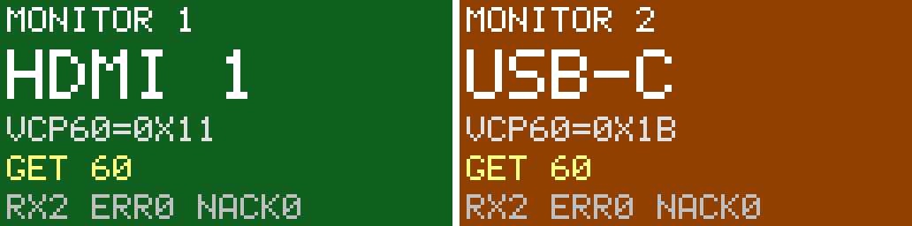

# STM32 DDC/CI Monitor-Switch Keypad

An STM32 keypad that switches two monitors between a PC and a Mac by sending
**DDC/CI** commands straight to each monitor over **I²C**. No software runs on
either computer, and no video passes through the keypad: it's a remote control
for the monitors' input selection.




```
 PC  --HDMI-------------+            +------------- Mac (USB-C)
                        v            v
                 [ Monitor 1: HDMI 1 | USB-C ]
                 [ Monitor 2: HDMI 2 | USB-C ]
                        ^
          DDC wires only, one I²C bus per monitor
                  (Monitor 1: PB8/PB9, Monitor 2: PA6/PA7)
                        |
                 [ STM32 keypad ]   "Monitor 1: show USB-C"
```

**Features**
- **Interrupt-driven input:** GPIO EXTI on falling edges. The line is masked
  during bounce, a 1 ms SysTick tick debounces it, and events go through a
  lock-free ring buffer to the main loop.
- **DDC/CI driver written from the VESA spec:** packet framing and XOR
  checksums, Set/Get VCP feature `0x60` (input source), spec timing
  (50 ms after a set, 40 ms before reading a reply), and null-message handling.
- **Non-blocking switch state machine:** set → wait → read back → verify,
  retrying with linear back-off. It reports OK, NACK, protocol error or
  mismatch. On real hardware the CPU can sleep (`__WFI`) between ticks
  (`USE_WFI 1`); it's off for Wokwi, whose STM32C0 model doesn't wake from WFI.
- **Simulated monitor (custom Wokwi chip in C):**
  - Validates packets and enforces DDC/CI timing.
  - Has an on-screen display.
  - Has a **fault-injection slider** that produces random NACKs and corrupted
    checksums, so you can watch the retry logic work.
- **One I²C bus per monitor:** every monitor answers at `0x37`, so each gets
  its own bit-banged bus on its own two GPIOs. No mux or bus switch.

---

## Step-by-step: run it in Wokwi (browser, free)

### 1. Start from Wokwi's STM32 HAL template
1. Sign in at https://wokwi.com. You need an account to save projects with
   custom chips.
2. Open the official **Nucleo-C031C6 STM32 HAL Example**:
   https://wokwi.com/projects/365551778332549121
3. Click **Save** (or **Save a copy**) so you have your own editable project.

> Start from this example rather than "New Project → STM32". The example is
> set up for plain C with the STM32Cube HAL, while the new-project route
> gives you an Arduino sketch.

### 2. Replace `main.c`
Open the `main.c` tab, delete everything, and paste in the contents of
**`wokwi/main.c`** from this project.

### 3. Add the simulated monitor chip
1. In the diagram pane, click the blue **+** button, then **Custom Chip**.
2. Name it exactly **`ddc-monitor`**, choose **C**, then click **Create Chip**.
   This creates two new tabs: `ddc-monitor.chip.json` and `ddc-monitor.chip.c`.
3. Replace the contents of each tab with the matching file from `wokwi/`.

The chip name matters: the wiring file refers to it as `chip-ddc-monitor`.

### 4. Replace `diagram.json`
Open the `diagram.json` tab and replace everything with **`wokwi/diagram.json`**.
The circuit appears with:
- the Nucleo board,
- two monitor chips with screens,
- six buttons,
- OK/ERR LEDs,
- a logic analyzer.

### 5. Run it
Press the green **▶ Play** button. The serial monitor should show:
```
=== STM32 DDC/CI Monitor Switch ===
Core clock 48 MHz, DDC: one software I2C bus per monitor
Left  monitor:  PC=HDMI1 (0x11)  Mac=USB-C (0x1B)
Right monitor:  PC=HDMI2 (0x12)  Mac=USB-C (0x1B)
Debounce tick: SysTick ISR
Buttons: EXTI interrupts (vector table in RAM @ 0x20000xxx)
Ready. Press a button.
```
Click **Left > PC**:
```
> Button: Left > PC
    TX 6E: 51 84 03 60 00 11 C9          <- Set VCP 0x60 = HDMI1
    TX 6E: 51 82 01 60 DC                <- Get VCP 0x60 (50 ms later)
    RX 6F: 6E 88 02 00 60 00 00 1B 00 11 DE   <- reply: value 0x11
[OK]   Left monitor -> HDMI1 (0x11) in 92 ms, 1 attempt(s)
```
- Monitor 1's screen turns green and shows **HDMI 1**.
- The green **OK** LED flashes.
- The board's on-board LED stays lit while the switch is in progress.

### 6. Show off the retry logic
1. While the simulation is running, click a monitor chip. A
   **Fault injection (%)** slider appears.
2. Set it to about 15 and press buttons. You'll see `<NACK>` lines in the log, and results
   such as `2 attempt(s)` where a retry recovered the switch.
3. At 40–50%, some switches fail after 3 attempts and the red **ERR** LED
   lights. The monitor screen counts `ERR` and `NACK` events.


---

## Project layout
```
firmware/Core/Inc/   ddc.h  keypad.h  switcher.h  sw_i2c.h  config.h   <- edit config.h for your monitors
firmware/Core/Src/   ddc.c  keypad.c  switcher.c  sw_i2c.c  main.c     <- main.c = HAL init + glue only
chip/                ddc-monitor.chip.c/.json                <- simulated DDC/CI monitor
wokwi/               files to paste into wokwi.com (main.c is generated)
tools/amalgamate.py  regenerates wokwi/main.c from the modules
```
After editing anything in `firmware/`, run `python3 tools/amalgamate.py` and
paste the new `wokwi/main.c` into Wokwi.


